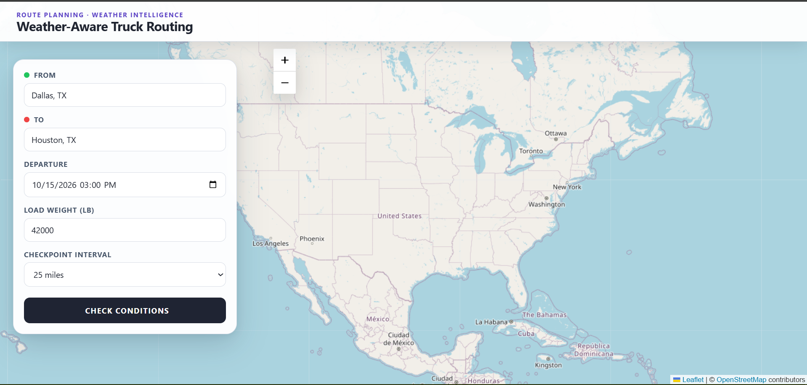
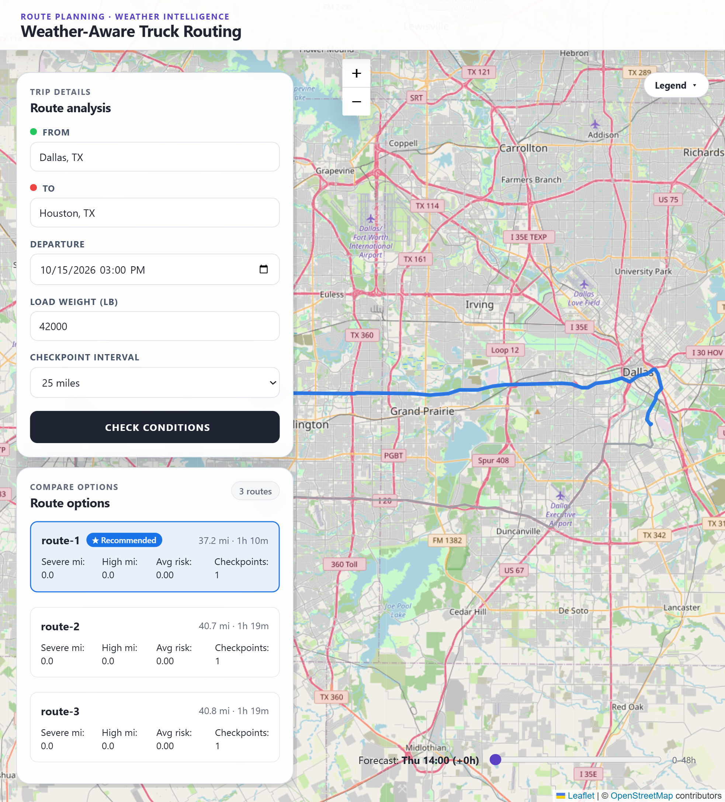
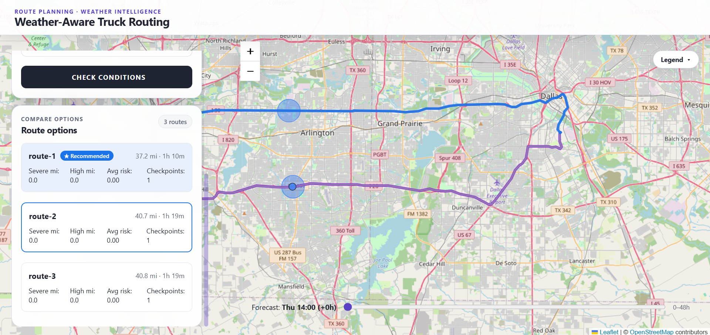
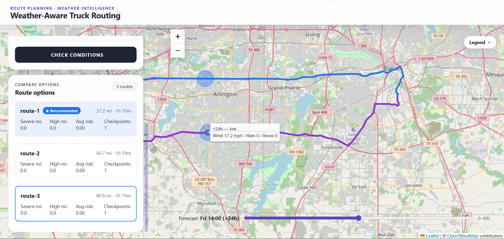
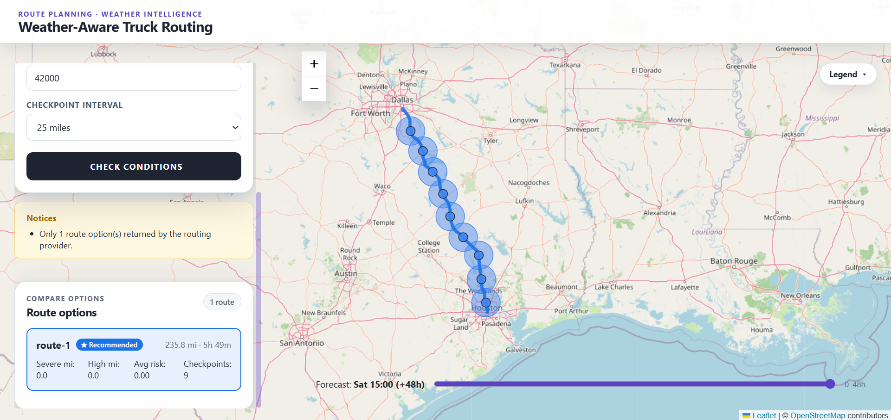

# Weather-Aware Truck Routing

A full-stack web app that helps a truck driver choose the safest route between two locations, balancing live weather risk, load weight, and travel time — built for the Spotter.ai Full Stack Developer take-home assessment.

**Live app:** https://weather-truck-routing-frontend.onrender.com
**Live API:** https://weather-truck-routing-api-dgnx.onrender.com
**Loom walkthrough:** <<add Loom link once recorded>>

> Note: the backend is hosted on Render's free tier and may take 30–60s to wake from a cold start on first request. A keep-alive monitor (UptimeRobot) pings `/api/health` every 5 minutes to minimize this.

---

## Table of Contents

- [Overview](#overview)
- [Architecture](#architecture)
- [Tech Stack](#tech-stack)
- [Setup & Local Development](#setup--local-development)
- [Running Tests](#running-tests)
- [API Contract](#api-contract)
- [Key Implementation Decisions](#key-implementation-decisions)
- [Known Simplifications & Limitations](#known-simplifications--limitations)
- [Screenshots](#screenshots)
- [Project Structure](#project-structure)

---

## Overview

The user enters an origin, destination, departure time, and load weight. The app:

1. Geocodes origin and destination.
2. Requests up to 3 alternative driving routes from OpenRouteService (HGV profile).
3. Places checkpoints along each route at a configurable interval (10 / 25 / 50 miles), interpolating each checkpoint's ETA from the route's actual per-step distance/duration data.
4. Fetches hourly weather (wind, rain, snow) for each checkpoint's coordinates and ETA from Open-Meteo.
5. Classifies each checkpoint's risk level (`low` / `moderate` / `high` / `severe` / `no_travel` / `unknown`) per documented threshold and load-override rules.
6. Aggregates each route's severe/high risk miles and average risk score, determines eligibility, and ranks eligible routes to recommend the safest/fastest option.
7. Builds a 0–48 hour corridor weather heatmap reusing the same checkpoint coordinates.
8. Surfaces explicit warnings when fewer than 3 routes are available, weather data is missing, or no route is safely eligible.

All of the above is returned from a single stateless `POST /api/routes/analyze` endpoint — no database, no authentication, per the assessment's scope.

## Architecture

```
┌─────────────┐      POST /api/routes/analyze      ┌──────────────────────┐
│   React UI   │ ─────────────────────────────────▶ │   Django + DRF API   │
│ (Leaflet map,│ ◀───────────────────────────────── │                      │
│  TripForm,   │        JSON response                │  TripAnalysisService │
│  heatmap)    │                                      │  (orchestration)    │
└─────────────┘                                      └──────────┬───────────┘
                                                                  │
                      ┌───────────────────────────────────────────┼────────────────────────────┐
                      ▼                                           ▼                             ▼
            ┌──────────────────┐                     ┌──────────────────────┐      ┌──────────────────────┐
            │ Geocoding Provider│                     │  Routing Provider     │      │  Weather Provider     │
            │  (ORS adapter)    │                     │  (ORS adapter,        │      │  (Open-Meteo adapter) │
            │                   │                     │   driving-hgv)        │      │                       │
            └──────────────────┘                     └──────────────────────┘      └──────────────────────┘
                                                                  │
                                                                  ▼
                                                      ┌──────────────────────┐
                                                      │   Domain Layer        │
                                                      │ (pure functions):     │
                                                      │ - risk_rules.py       │
                                                      │ - recommendation.py   │
                                                      │ - geo.py              │
                                                      │ No I/O, no imports    │
                                                      │ of Django/requests.   │
                                                      │ Fully unit-testable.  │
                                                      └──────────────────────┘
```

**Key architectural principle:** provider adapters (routing/weather/geocoding) sit behind abstract base classes (`RoutingProvider`, `WeatherProvider`, `GeocodingProvider`) so swapping a provider only touches one adapter file. The domain layer (risk classification, route ranking/eligibility) has zero I/O — no Django, no `requests`, no provider SDKs — so it is pure-function and unit-testable without mocks.

See [`docs/architecture.md`](docs/architecture.md) for the full breakdown.

## Tech Stack

| Layer | Choice |
|---|---|
| Frontend | React 19 + Vite, React-Leaflet, Leaflet |
| Backend | Django 6.1 + Django REST Framework |
| Routing/Geocoding | OpenRouteService (`driving-hgv` profile) |
| Weather | Open-Meteo (no API key required) |
| Hosting | Render (backend: Web Service / gunicorn; frontend: Static Site) |
| Uptime monitoring | UptimeRobot (pings `/api/health` every 5 min) |
| Testing | pytest (backend domain + service layer) |

## Setup & Local Development

### Prerequisites

- Python 3.12.5 (or compatible)
- Node.js 24.14.1 (or compatible)
- An OpenRouteService API key (free tier): https://openrouteservice.org/dev/#/signup

### Backend

```bash
cd backend
python -m venv venv
source venv/bin/activate      # Windows: venv\Scripts\activate
pip install -r requirements.txt

cp .env.example .env
```

Edit `.env` and set:

```
SECRET_KEY=<generate a real secret key for local dev>
DEBUG=True
ALLOWED_HOSTS=localhost,127.0.0.1
CORS_ALLOWED_ORIGINS=http://localhost:5173
ORS_API_KEY=<your OpenRouteService API key>
```

Run the server:

```bash
python manage.py runserver
```

API available at `http://localhost:8000`.

### Frontend

```bash
cd frontend
npm install
```

Create `frontend/.env.local`:

```
VITE_API_BASE_URL=http://127.0.0.1:8000
```

Run the dev server:

```bash
npm run dev
```

Frontend available at `http://localhost:5173`.

## Running Tests

```bash
cd backend
pytest
```

All risk classification boundary cases (low/moderate/high/severe/no_travel thresholds, load-weight overrides) and route recommendation/eligibility logic are covered by unit tests against the pure domain layer — no mocking of external providers required for these.

## API Contract

Full request/response contract, error shapes, and field semantics: [`docs/api-contract.md`](docs/api-contract.md)

Example request:

```json
POST /api/routes/analyze
{
  "origin": "Dallas, TX",
  "destination": "Houston, TX",
  "departure_time": "2026-10-14T08:00:00-05:00",
  "load_weight_lb": 42000,
  "checkpoint_interval_miles": 25
}
```

## Key Implementation Decisions

The assessment brief intentionally leaves several behaviors undefined (overlapping threshold boundaries, how to combine wind/rain/snow into one risk level, how checkpoint risk converts to route-level miles, route eligibility when a `no_travel` checkpoint exists, behavior when fewer than 3 routes or missing weather data occur, and the heatmap's reference time). All of these are explicitly documented, with rationale, in:

**[`docs/DECISIONS.md`](docs/DECISIONS.md)**

Highlights:
- Thresholds are half-open intervals (`low ≤ x < next_level`), matching the brief's stated ranges.
- A checkpoint's base risk is the **most severe** of wind/rain/snow, with load-weight overrides applied on top (can only escalate, never reduce).
- A route with any `no_travel` checkpoint is marked ineligible and excluded from recommendation, but still shown in the UI (flagged) rather than hidden.
- Missing weather data is classified `unknown`, never defaulted to `low`, and surfaced via explicit warnings — affected checkpoints are excluded from mile totals and average risk.
- The routing provider (ORS) rejects alternative-route requests above ~100km road distance; a straight-line pre-check avoids this slow, doomed request and degrades gracefully to a single route with a "fewer than 3 routes" warning, rather than fabricating routes.

## Known Simplifications & Limitations

- No HGV-specific restriction parameters (height/weight/hazmat) are sent to the routing provider — a documented simplification given the assessment's time budget.
- No database/persistence is used by the application logic — the API is fully stateless by design; each request is independently analyzed. (Django's default SQLite config exists only as part of the project scaffold — no models are defined or used.)
- Free-tier hosting (Render) and free-tier routing API (ORS) impose rate limits and cold-start latency; mitigated with health-check pinging but not eliminated.
- For trips with straight-line distance ≥55 miles, OpenRouteService typically cannot provide 3 alternative routes (hard distance cap on its `alternative_routes` feature); the app returns the real route(s) available with an explicit warning rather than fabricating alternatives. See `docs/DECISIONS.md` §7.

## Screenshots

**Trip input form**


**Route options with risk-colored checkpoints**


**Route summary cards (severe/high miles, average risk, eligibility)**


**0–48h weather heatmap slider**


**Edge case: warning banner (fewer routes / high load weight escalation)**


## Project Structure

```
weather-truck-routing/
├── backend/
│   ├── config/                   # Django project (settings.py, urls.py, wsgi.py)
│   ├── healthcheck/               # /api/health endpoint app
│   ├── trip_analysis/
│   │   ├── domain/                # pure functions: risk_rules.py, recommendation.py, geo.py, types.py
│   │   ├── providers/
│   │   │   ├── geocoding/
│   │   │   ├── routing/           # ors_provider.py
│   │   │   └── weather/           # open_meteo_provider.py
│   │   ├── services/              # checkpoint_service.py, trip_analysis_service.py
│   │   └── tests/
│   ├── requirements.txt
│   └── .env.example
├── frontend/
│   └── src/
│       ├── api/                   # tripApi.js
│       ├── components/            # MapView, RouteLayer, CheckpointMarkers, TripForm, etc.
│       └── App.jsx
└── docs/
    ├── requirements.md
    ├── architecture.md
    ├── api-contract.md
    ├── DECISIONS.md
    └── MASTER_PLAN.md
```
